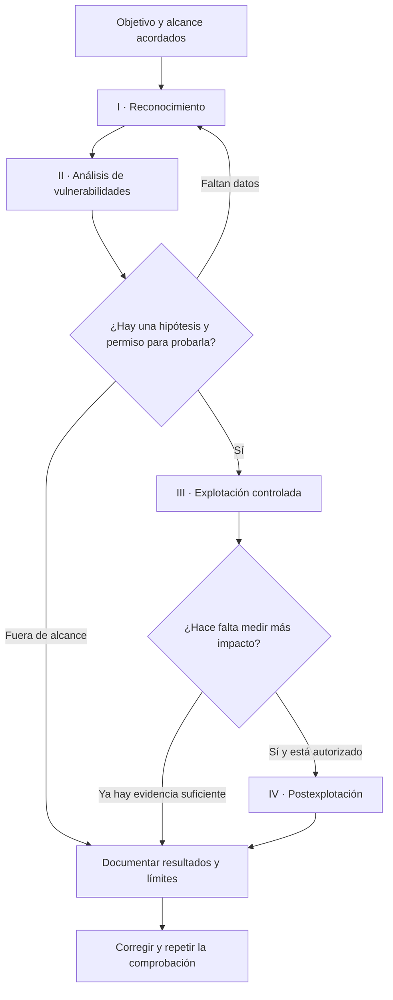

# Unidad 1 · Introducción al pentesting

**Pregunta de partida.** El centro publica una web para compartir prácticas. Una alumna descubre que, si conoce el nombre de un archivo, puede descargarlo sin iniciar sesión. ¿Ha encontrado un fallo? Depende de qué archivos debían ser públicos. Antes de abrir otra URL necesitamos conocer el comportamiento esperado y tener autorización para comprobarlo.

Al terminar esta unidad podrás delimitar una prueba de intrusión, explicar sus cuatro fases técnicas y redactar un hallazgo que otra persona pueda reproducir. Para la práctica necesitarás una terminal Linux, Python 3, curl y Nmap.

## 1. Qué pregunta responde una prueba de intrusión

Un **pentest** es una evaluación autorizada en la que se intenta demostrar hasta dónde llega un atacante bajo unas condiciones acordadas. «¿Puede un visitante anónimo leer un documento reservado al profesorado?» es una pregunta verificable. Para responderla hacen falta un objetivo concreto, una identidad de prueba y una evidencia que permita distinguir el éxito del fracaso.

| Concepto | En la web de prácticas |
|---|---|
| Activo | Un documento de evaluación que solo debería leer el profesorado |
| Superficie de ataque | Las rutas y servicios a los que llega un visitante |
| Vulnerabilidad | El servidor entrega un documento restringido sin comprobar la identidad |
| Impacto | Un visitante puede leer información reservada |
| Riesgo | La posibilidad de que ocurra esa lectura y las consecuencias para el centro |

Un escáner puede señalar puertos, versiones o configuraciones sospechosas. El trabajo del pentester incluye decidir qué comprobar, reproducir el comportamiento y explicar a quién afecta. Un puerto abierto puede ser imprescindible para prestar el servicio. Una versión anunciada puede incluir parches del distribuidor. Ambas observaciones necesitan contexto.

## 2. Antes de probar

El cliente y el equipo acuerdan por escrito los sistemas incluidos, quién autoriza, desde dónde y cuándo se probará, técnicas permitidas, datos que se pueden utilizar y a quién avisar ante un incidente. Si aparece un dominio de un proveedor al investigar la web, se registra la relación y se consulta el alcance antes de probarlo.

El conocimiento inicial también cambia el ejercicio. En **caja negra** el equipo parte de información externa mínima. En **caja gris** puede disponer de una cuenta de alumno. En **caja blanca** puede revisar además el código y la configuración. Con una cuenta de alumno se puede formular una pregunta distinta: ¿se comprueba el permiso al pedir el documento directamente después de iniciar sesión?

## 3. Las fases y sus decisiones

El capítulo 1 del libro describe cuatro fases de un ataque. En un encargo profesional las enmarcamos entre el acuerdo inicial y la entrega de resultados. El alcance determina hasta dónde avanzar.



### I · Reconocimiento. ¿Qué hay y cómo lo sé?

En un reconocimiento **pasivo** se aprovechan fuentes ya existentes, por ejemplo un índice público de certificados. Encontrar allí un nombre sugiere que se usó, aunque podría estar obsoleto. En el **activo** se interactúa con la infraestructura, por ejemplo al intentar conectar con un puerto. Anota siempre fuente, fecha y activo. OSINT describe el uso de fuentes abiertas. El carácter activo o pasivo depende de cómo se obtiene el dato.

### II · Análisis de vulnerabilidades. ¿Qué podría fallar?

Cruza el inventario con las reglas del sistema. Si un servicio publica el contenido de una carpeta y el procedimiento de despliegue copia allí archivos internos, surge una hipótesis concreta de exposición. Registra las condiciones necesarias y elige la comprobación más pequeña que permita resolver la duda. Si un escáner avisa de un fallo de versión, contrasta el paquete instalado, sus parches y la configuración afectada.

### III · Explotación. ¿Puedo demostrarlo?

Reproduce la condición con el nivel de acceso acordado. Para un problema de lectura anónima puede bastar una petición HTTP sin credenciales a un documento señuelo. Guarda la petición, el resultado y el comportamiento esperado. Un código 200 por sí solo es ambiguo: una aplicación puede devolver su pantalla de acceso con ese mismo código.

### IV · Postexplotación. ¿Hasta dónde llega el acceso?

Tras conseguir acceso, podría interesar qué permisos tiene una cuenta o qué recurso de prueba alcanza desde ese punto. El libro incluye aquí la exfiltración. En el caso del documento, leer una marca ficticia ya demuestra el impacto previsto. Descargar una carpeta entera añadiría exposición sin responder a otra pregunta del encargo.

### Herramientas y preguntas que ayudan a responder

| Momento | Herramienta o técnica | Qué aporta y cómo interpretarlo |
|---|---|---|
| Reconocimiento de fuentes abiertas | theHarvester | Reúne nombres y direcciones publicados en distintas fuentes. Comprueba vigencia y titularidad. |
| Enumeración DNS | dig | Consulta registros como A o MX. El servidor consultado y el tipo de consulta determinan quién observa el tráfico. |
| Descubrimiento de servicios | Nmap | Comprueba desde tu punto de red qué puertos responden. La detección de servicio orienta las siguientes pruebas. |
| Revisión con acceso local | Lynis | Examina configuración y medidas de endurecimiento del sistema. Cada sugerencia necesita contexto. |
| Investigación de servicios | Legion, tratado junto a Sparta en el libro | Agrupa resultados de enumeración y comprobaciones. Revisa la evidencia de cada resultado. |
| Análisis de protocolos de red | Yersinia | Permite estudiar debilidades de protocolos de capa 2 en una red de laboratorio aislada. |
| Validación web | curl | Reproduce una petición exacta y permite comparar cabeceras y contenido antes y después de la corrección. |

## 4. Laboratorio guiado · Un archivo en la carpeta equivocada

**Encargo.** La portada debe ser pública. El archivo ficticio de evaluación debe quedar fuera del directorio publicado. El único objetivo autorizado es tu propio servidor en 127.0.0.1, puerto 8765. La pregunta es si un visitante que conoce la ruta puede leer la marca de prueba.

**1. Prepara el escenario.** En una terminal ejecuta este bloque. Mantén la terminal abierta. Si el puerto está ocupado, detente para evitar comprobar otro servicio.

```bash
aula=$(mktemp -d)
mkdir "$aula/publico"
echo 'Portal de prácticas' > "$aula/publico/index.html"
echo 'MARCA-AULA-01' > "$aula/publico/evaluacion.txt"
python3 -m http.server 8765 --bind 127.0.0.1 --directory "$aula/publico"
```

**2. Reconoce el servicio.** Desde otra terminal ejecuta:

```bash
nmap -sT -sV -p 8765 127.0.0.1
```

Busca la fila de 8765/tcp. El estado esperado es `open`. La identificación de versión puede variar. ¿Qué parte de la pregunta del encargo sigue sin respuesta?

**3. Contrasta la hipótesis.** Solicita la portada y el documento sin enviar credenciales:

```bash
curl -i http://127.0.0.1:8765/
curl -i http://127.0.0.1:8765/evaluacion.txt
```

La primera respuesta sirve de control. En la segunda, busca el estado 200 y la marca `MARCA-AULA-01`. Ahora puedes afirmar que un cliente local sin credenciales leyó el señuelo. Para afirmar que era accesible desde Internet necesitarías otra prueba y otro alcance.

**4. Corrige y verifica.** Detén el servidor con Ctrl+C en la primera terminal. Allí mismo, mueve el documento fuera de la carpeta publicada y vuelve a arrancar:

```bash
mv "$aula/publico/evaluacion.txt" "$aula/evaluacion.txt"
python3 -m http.server 8765 --bind 127.0.0.1 --directory "$aula/publico"
```

Repite ambas peticiones. Debes obtener 200 y la portada en la primera, y 404 sin la marca en la segunda. Si ambas conexiones fallan, el servicio está caído y la corrección sigue sin verificar. Detén el servidor al terminar.

## 5. Del resultado al informe

> **Hallazgo · Lectura anónima del archivo de evaluación.** El servidor local entregó la marca ficticia al solicitar `/evaluacion.txt` sin credenciales. El documento estaba dentro de la carpeta pública. Cualquier cliente con acceso al servicio y conocimiento de la ruta podía leerlo. Tras moverlo fuera del directorio publicado, la misma petición devolvió 404 y la portada siguió disponible.

Como entrega, añade a este ejemplo la fecha, el origen de la prueba y dos extractos de tus respuestas HTTP. Explica qué cambiaría en el impacto si el archivo contuviera calificaciones reales y el servicio fuera público. Si el profesorado necesitara descargarlo por web, ¿qué control debería aplicar el servidor en cada petición?

## 6. Comprueba lo aprendido

1. Un certificado antiguo menciona un subdominio. ¿Qué sabes y qué queda por comprobar?
2. El escáner muestra 8765/tcp abierto después de la corrección. ¿Es compatible con haber resuelto el hallazgo?
3. La aplicación oculta el enlace al archivo al cerrar sesión. ¿Qué prueba harías?
4. Ya has leído el señuelo. ¿Qué justificaría entrar en la fase IV?

<details>
<summary>Soluciones razonadas</summary>

1. El nombre figuraba en el certificado. Falta comprobar vigencia, titularidad y autorización antes de interactuar con él.
2. Sí. La web debe seguir disponible. La comprobación decisiva es que la ruta ya no entrega la marca.
3. Repetiría la petición directa sin cookies ni cabeceras de autenticación y examinaría el contenido devuelto. Ocultar un enlace solo cambia la interfaz.
4. Una pregunta adicional sobre el impacto, prevista en el alcance y todavía sin resolver. Para el encargo del laboratorio ya basta la evidencia recogida.

</details>

**Lectura en el libro.** David Santo Orcero, *Pentesting con Kali*, parte segunda, 15.ª edición (2025). El capítulo 1 presenta las fases (pp. 1–16), el 2 desarrolla OSINT, DNS, escaneo y revisión local (pp. 17–72) y el 3 introduce el análisis de vulnerabilidades (pp. 73–101). Las páginas corresponden a la numeración impresa. El caso del portal y el laboratorio son ejemplos propios para esta unidad.
