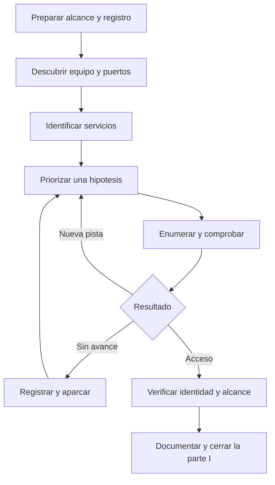

# Pentesting en laboratorio: guía de método y fichas de campo

**Parte I · Del descubrimiento al acceso inicial**  
Primera versión docente · 17 de noviembre de 2026

¿Por dónde empiezo si una máquina tiene cinco puertos abiertos? ¿Qué hago después de encontrar una web? ¿Cuándo conviene cambiar de servicio? Estos apuntes ayudan a responder esas preguntas en máquinas de laboratorio (como paso previo al hacking ético en un entorno corporativo real). No pretenden garantizar una shell u otro tipo de acceso o ataque exitoso en cualquier máquina: enseñan a construir y comprobar hipótesis.

## Qué aprenderás

- Localizar el objetivo y reconocer sus servicios sin confundir un puerto con una vulnerabilidad.
- Elegir pruebas según la evidencia y explicar por qué se hacen.
- Relacionar información encontrada en servicios diferentes.
- Conseguir, cuando las condiciones lo permitan, acceso inicial y demostrar qué acceso es.
- Documentar un bloqueo con suficiente precisión para retomarlo.

**Entorno previsto:** equipo atacante con Kali Linux —podría valer otra distribución con la herramientas necesarias instaladas— y máquinas vulnerables en una red de laboratorio aislada. Los comandos de terminal están pensados para Bash. Necesitas fundamentos de IP, puertos, HTTP y terminal. Si usas una VPN de laboratorio, respeta su alcance: ARP no atraviesa routers y no sirve para descubrir máquinas remotas a través de ella.

## Cómo utilizar estos apuntes

**Primera lectura:** sigue las fases 1, 2 y 3; abre después la ficha del servicio elegido. **Durante la práctica:** usa las rutas rápidas y vuelve al desarrollo cuando no entiendas un resultado. Completa una [hoja de trabajo](plantilla-de-trabajo.md) por máquina.

Las salidas y los casos narrativos se identifican como ejemplos didácticos. No son evidencias de una ejecución realizada por el autor. Cambia las IP, nombres, rutas y puertos por los de tu laboratorio. Los bloques `text` muestran resultados o interacciones, no órdenes para pegar en Bash. Los bloques `console` de Metasploit se ejecutan dentro de su consola.

## Mapa del proceso

## Índice

### Método común

1. [Método, preparación y registro](01-metodo-y-registro.md)
2. [Descubrimiento, puertos y reconocimiento de servicios](02-descubrimiento-y-reconocimiento.md)
3. [Priorización de servicios y gestión de bloqueos](03-priorizacion-de-servicios.md)

### Fichas de campo

4. **HTTP y HTTPS**
   - [Ruta de enumeración web](04-web/00-ruta-web.md)
   - [Inspección inicial, nombres de host y HTTPS](04-web/01-inspeccion-inicial.md)
   - [Descubrimiento de contenido y aplicaciones](04-web/02-descubrimiento-de-contenido.md)
   - [Funcionalidades, hipótesis y vías de acceso](04-web/03-funcionalidades-y-acceso.md)
5. [FTP: acceso, archivos y conexiones con otros servicios](05-ftp.md)
6. [SSH: de las pistas a una sesión autenticada](06-ssh.md)
7. [SMB: recursos compartidos y permisos](07-smb.md)
8. [Usuarios, credenciales, archivos y componentes vulnerables](08-conectar-hallazgos.md)
9. [Acceso inicial: obtención, verificación y cierre](09-acceso-inicial.md)

### Práctica y consulta

- [Plantilla de trabajo por máquina](plantilla-de-trabajo.md).
- [Caso razonado A: archivos expuestos → credenciales → SSH](ejemplos/01-archivos-a-ssh.md).
- [Caso guiado B: servicio vulnerable en Metasploitable 2](ejemplos/02-metasploitable-ftp.md).
- [Guía docente: progresión, preguntas y evaluación](guia-docente.md).
- [Fuentes y documentación de herramientas](FUENTES.md).

## Qué cubre esta versión y qué queda después

El recorrido principal se centra en Linux, web, FTP, SSH y SMB. Incluye una orientación para otros servicios y una introducción a pruebas web frecuentes. No desarrolla una metodología completa de Active Directory, auditoría de aplicaciones, cracking, fuerza bruta ni pivotado. Las máquinas de dificultad media pueden exigir ampliar una ficha o consultar documentación específica.

El objetivo de la parte I es una sesión de sistema o ejecución de comandos verificada. Un panel administrativo se registra como acceso a la aplicación: no equivale automáticamente a una shell. La enumeración local sistemática, mejora de la terminal y escalada se reservan para partes posteriores. No se incluye persistencia.

## Acuerdo de laboratorio

Prueba únicamente las máquinas asignadas. Mantén las máquinas deliberadamente vulnerables fuera de redes de producción. El alcance y las técnicas permitidas se anotan una vez al comenzar. Al terminar, documenta cambios y restaura la instantánea cuando lo indique el ejercicio.

**Regla de trabajo:** antes de cada prueba, escribe qué quieres averiguar; después, qué has aprendido y qué decisión cambia.
