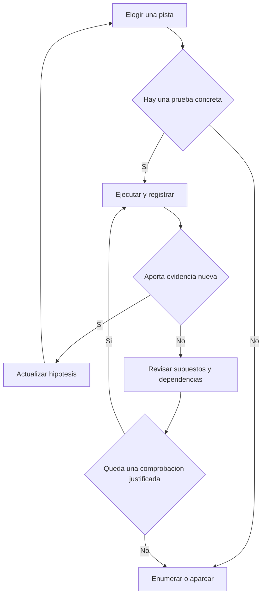

# 3 · Elegir por dónde seguir y cuándo cambiar

[Índice](README.md) · [Anterior: reconocimiento](02-descubrimiento-y-reconocimiento.md) · [Siguiente: web](04-web/00-ruta-web.md)

## Ruta rápida

**Pista concreta → prueba breve → resultado interpretable → siguiente decisión.** Si falta la pista, realiza la enumeración básica. Si dejas de aprender, aparca la vía con una condición para retomarla.

## No existe un orden universal de servicios

Prioriza por evidencia, información accesible, coste y dependencias. Un servicio puede ser interesante porque entrega archivos, aunque por sí mismo no proporcione una shell.

| Hallazgo | Primera pregunta | Vía razonable |
|---|---|---|
| Web pública | ¿Qué aplicación y funciones ofrece? | [Inspección web](04-web/01-inspeccion-inicial.md). |
| FTP con posible acceso anónimo | ¿Qué permite leer y qué información aporta? | [FTP](05-ftp.md). |
| SMB accesible | ¿Hay recursos legibles con acceso invitado o con mi cuenta? | [SMB](07-smb.md). |
| SSH sin usuario ni credenciales | ¿La identificación está completa? | Registrar y buscar pistas en otros servicios; [SSH](06-ssh.md). |
| Credencial vinculada a un servicio | ¿Es vigente y corresponde a este destino? | Validación manual contextual; [conectar hallazgos](08-conectar-hallazgos.md). |
| Componente con versión aparente | ¿Coinciden versión, configuración y requisitos de un fallo documentado? | Investigar antes de ejecutar una prueba. |
| Puerto desconocido | ¿Qué protocolo responde? | Volver a `-sV`, revisar respuesta y documentación. |

**Ejemplo:** con 21, 22, 80 y 8080 abiertos, una lectura breve del FTP y de ambas webs puede producir pistas. SSH puede quedar pendiente hasta disponer de identidad y credencial. Pero si ya tienes una clave SSH y usuario documentados, esa vía podría ir primero.

## Otros servicios: no ignorarlos

Esta primera versión no contiene fichas completas para todos ellos. Registra y deriva cuando aparezcan:

| Servicio probable | Qué buscar inicialmente | Qué no asumir |
|---|---|---|
| DNS, 53 TCP/UDP | Nombres y relación con la web; consultas al servidor del laboratorio. | Que una transferencia de zona esté permitida o vaya a funcionar. |
| NFS/RPC, 2049/111 | Exportaciones y restricciones de acceso. | Que todo recurso permita escritura o acceso como administrador. |
| Base de datos, 3306/5432/1433 | Motor, exposición y credenciales de aplicación encontradas. | Que un acceso de base de datos proporcione shell de sistema. |
| SNMP, 161 UDP | Versión, configuración prevista y comunidad si la proporciona el ejercicio. | Que no responder equivalga a ausencia de servicio. |
| RDP/WinRM, 3389/5985/5986 | Autenticación disponible y requisitos de la cuenta. | Que una cuenta válida tenga permiso de acceso remoto. |
| SMTP, 25/465/587 | Dominio, capacidades y relación con usuarios del caso. | Que enumerar usuarios esté siempre permitido o sea fiable. |

Los puertos son pistas, no identificaciones definitivas. Si la máquina depende de uno de estos servicios, amplía la metodología con documentación específica y deja constancia de la limitación de estos apuntes.

## Semáforo de hipótesis

- **Activa:** tengo evidencia concreta y una prueba que puede resolver una duda.
- **Pendiente:** falta una dependencia, como una cuenta o el nombre de host.
- **Aparcada:** ya hice las comprobaciones básicas y no tengo una nueva prueba razonada.
- **Descartada para estas condiciones:** una evidencia contradice el requisito. Explica cuál; no afirmes que el servicio es invulnerable.

## Cómo aparcar bien

Escribe: «Probé X sobre Y. Obtuve Z. Falta W. Retomaré cuando ocurra Q». Por ejemplo: «SSH identificado en 22; no dispongo de cuenta ni clave. Retomar si web o FTP aporta una credencial de sistema».

Antes de abandonar toda la máquina, revisa: puertos altos, aplicación por nombre de host, redirecciones, archivos descargados, rutas enlazadas, segunda web, UDP pendiente y credenciales aún sin contextualizar. No aumentes el tamaño de los diccionarios por defecto.

## Comprueba tu criterio

Tienes una web con un archivo de copia enlazado y un SSH sin credenciales. ¿Qué harías primero? Examinar el archivo y su contexto: es una pista concreta y barata. Esto no demuestra que contenga una contraseña ni que esta sea válida en SSH.

- [ ] Mi siguiente paso tiene una razón escrita.
- [ ] Conservo una lista de vías pendientes.
- [ ] Sé qué evidencia me haría retomar cada vía.

[Índice](README.md) · [Anterior: reconocimiento](02-descubrimiento-y-reconocimiento.md) · [Siguiente: web](04-web/00-ruta-web.md)
