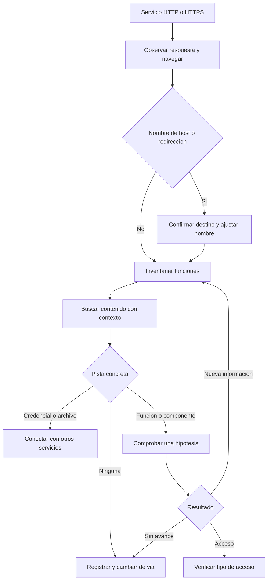

# 4 · Ruta de enumeración web

[Índice](../README.md) · [Anterior: priorización](../03-priorizacion-de-servicios.md) · [Siguiente: inspección](01-inspeccion-inicial.md)

**Punto de partida:** has confirmado HTTP o HTTPS en algún puerto, no necesariamente 80 o 443. **Objetivo:** comprender la aplicación y elegir una vía de investigación respaldada por su comportamiento.

## Ruta rápida

1. Abre el servicio en el navegador y conserva una respuesta con curl.
2. Identifica redirecciones y el nombre de host esperado.
3. Recorre enlaces y funcionalidades; distingue servidor, aplicación y componentes.
4. Busca contenido adicional de forma dirigida.
5. Formula una hipótesis sobre una función o componente.
6. Comprueba la hipótesis, relaciona hallazgos y reevalúa.

## ¿Qué ficha necesito?

| Lo que observas | Ficha |
|---|---|
| Página por defecto, error TLS, redirección o web distinta por nombre | [Inspección inicial](01-inspeccion-inicial.md). |
| Necesitas localizar rutas, archivos o una segunda aplicación | [Descubrimiento de contenido](02-descubrimiento-de-contenido.md). |
| Login, subida, descarga, parámetro o componente identificado | [Funcionalidades y acceso](03-funcionalidades-y-acceso.md). |
| Usuario, contraseña, clave o configuración descargada | [Conectar hallazgos](../08-conectar-hallazgos.md). |
| Ejecución de comandos o sesión obtenida | [Acceso inicial](../09-acceso-inicial.md). |

## Qué registrar

URL completa, IP, puerto, esquema, nombre de host, redirecciones, identidad de prueba, funciones, tecnologías y evidencias. Separa «cabecera anuncia Apache» de «aplicación es WordPress»: son capas distintas. Una aplicación puede depender también de complementos, proxy inverso y base de datos.

## Cuándo aparcar

Has revisado nombre correcto, navegación, funciones, pistas del código fuente y una búsqueda de contenido proporcionada; no quedan hipótesis específicas. Retoma al aparecer una cuenta, otro nombre de host, ruta, archivo o componente nuevo. Un escaneo sin resultados no equivale a web segura.

- [ ] He explorado cada aplicación relevante, incluidos otros puertos.
- [ ] Mi conclusión va más allá del nombre del servidor.
- [ ] Puedo señalar la evidencia de mi siguiente prueba.

[Índice](../README.md) · [Siguiente: inspección](01-inspeccion-inicial.md)
