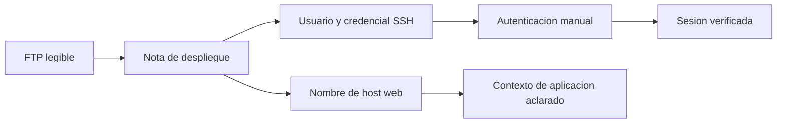

# Caso A · De archivos expuestos a SSH

[Índice](../README.md) · [Anterior: acceso inicial](../09-acceso-inicial.md) · [Siguiente: caso B](02-metasploitable-ftp.md)

**Caso narrativo ficticio para practicar decisiones.** No corresponde a una máquina publicada ni presenta resultados ejecutados. El docente puede reproducir la situación en una VM propia; aquí se estudia la cadena lógica, no se proporciona una imagen instalable.

## Situación inicial

El inventario muestra FTP en 21, SSH en 22, HTTP en 80 y otra web en 8080. No hay credenciales iniciales. El objetivo es una sesión de sistema como usuario sin privilegios administrativos.

Antes de continuar, escribe qué dos comprobaciones harías primero y qué esperas aprender.

## Decisión 1 · Identificar todo y elegir pruebas breves

Se identifican los cuatro servicios. La portada del puerto 80 es una página de bienvenida; 8080 contiene una aplicación de incidencias con login. FTP permite acceso anónimo y muestra `LEEME.txt` y un directorio `documentacion`.

**Razonamiento:** el FTP ofrece contenido legible sin dependencias. Revisarlo puede ayudar tanto a la aplicación como a SSH. La web de 8080 permanece pendiente; SSH espera credenciales. No se descarta ninguno.

## Decisión 2 · Leer con contexto

`LEEME.txt` indica que la aplicación de incidencias usa el nombre `soporte.lab`. Una nota de despliegue especifica una cuenta de sistema `operador` para mantenimiento por SSH y una contraseña temporal del ejercicio, que se registra como `CRED-01`.

**Hechos:** hay un nombre de host y una credencial que la nota vincula a SSH. **Hipótesis:** esa credencial sigue vigente en el objetivo. No sabemos todavía si la cuenta puede abrir una shell.

## Decisión 3 · Corregir una suposición

Al visitar el puerto 8080 por IP, la aplicación redirige al nombre indicado. Se configura la resolución local para revisar la aplicación correctamente. Se descubre que el login web usa cuentas de aplicación distintas.

**Descarte razonado:** no se asume que `operador` tenga acceso al panel. No se gasta una ronda de intentos web sin fundamento. Esta exploración ha aclarado el contexto, aunque no ha dado acceso.

## Decisión 4 · Validar una vía concreta

Siguiendo [SSH](../06-ssh.md), se realiza una autenticación manual con `operador` y `CRED-01` en el puerto identificado. En este relato, funciona y abre sesión.

Dentro de la sesión, `id`, `hostname` y `pwd` muestran la cuenta y el contexto de la VM esperada. Se conserva un extracto y se cierra la sesión al terminar el ejercicio.

**Conclusión:** la exposición de documentación con una credencial vigente permitió acceso al sistema. La debilidad no era simplemente «FTP abierto» ni «SSH vulnerable».

## ¿Y si falla?

| Variante | Decisión razonable |
|---|---|
| FTP rechaza anónimo | Aparcar la lectura y explorar las aplicaciones. |
| La nota no contiene credencial | Conservar usuario y nombre; falta una dependencia. |
| SSH rechaza la contraseña | Revisar destino, cuenta y contexto; puede haber caducado. Registrar y retomar web. |
| SSH autentica pero solo permite SFTP | Registrar acceso a archivos; objetivo de shell aún no logrado. |
| El nombre web muestra otra aplicación | Crear un inventario separado y volver a la ficha web. |

## Preguntas

1. ¿Qué evidencia justificó probar SSH?
2. ¿Por qué el nombre `soporte.lab` era relevante?
3. ¿Qué demostraría un login web exitoso, y qué no?
4. ¿Qué corrección propondrías para la cadena encontrada?

Soluciones razonadas

1. La nota vinculaba cuenta y credencial al servicio, en ese entorno.
2. Permitía acceder al sitio esperado y entender su contexto; la IP no siempre selecciona la misma aplicación.
3. Acceso a la aplicación con los permisos de esa cuenta; no demuestra shell ni identidad de sistema.
4. Retirar la documentación sensible de la exposición, rotar la credencial y revisar por qué se almacenó allí. Cerrar SSH sin analizar su necesidad no resuelve por sí solo la causa.

[Índice](../README.md) · [Siguiente: caso B](02-metasploitable-ftp.md)
